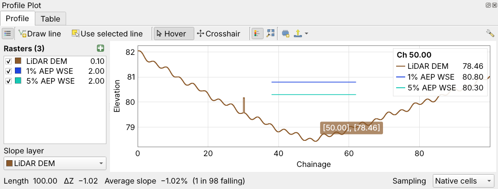
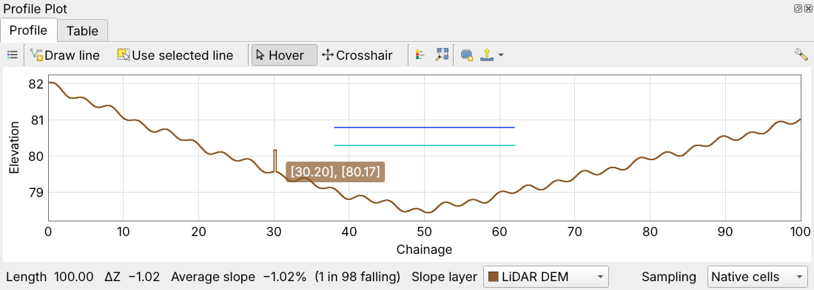
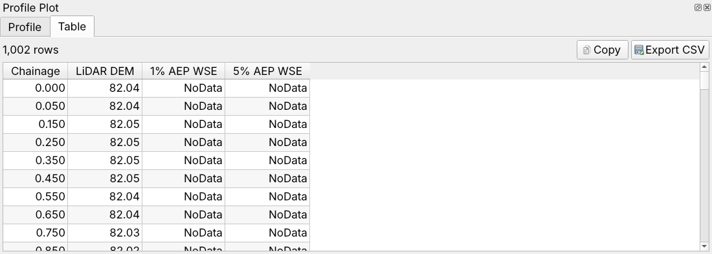

# Profile Plot

Fast raster profiles for QGIS. Press one shortcut, click a line on the map and the
profile of every raster you picked (LiDAR DEM, flood water surfaces, design surfaces, …)
appears straight away: live while you draw, at the rasters' native resolution once you finish.


## Install

* **From ZIP:** run `python3 scripts/package.py` (or use the released ZIP), then in QGIS go to
  *Plugins ▸ Manage and Install Plugins ▸ Install from ZIP*.
* **From source:** copy or symlink the `profile_plot` folder into your QGIS profile's
  `python/plugins` folder and enable **Profile Plot** in the Plugin Manager.

QGIS 3.34 or newer, including QGIS 4 (Qt6). No extra Python packages are needed:
it uses numpy, GDAL and Qt, which ship with QGIS, and works offline.

## Quick start

1. Click the **Profile Plot** toolbar icon (or *Raster ▸ Profile Plot*). The dock opens.
2. Click **+** (Add raster) and pick one or several rasters, or drag layers into the dock from
   the Layers panel or the Browser.
3. Press the icon or your shortcut again (or **Draw line** in the dock) and draw:

   | Action | How |
   |---|---|
   | Add a vertex | left-click |
   | Undo the last vertex | Backspace |
   | Finish | right-click (or Enter) |
   | Cancel the current line | Esc |
   | Leave the tool | Esc when no line is in progress, or pick another map tool |

   The plot follows the mouse while you draw. After you finish, the tool **stays in draw mode**,
   so the next click starts a new profile.

### Assign your shortcut

The toolbar icon and *Draw line* share one action, **Profile Plot**, which has **no default
key**. Assign one in *Settings ▸ Keyboard Shortcuts* (search “Profile Plot”). QGIS saves it
and warns about clashes with existing shortcuts. Pressing the shortcut:

* opens the dock and starts drawing, if the dock is closed;
* starts a new line, if the dock is already open.

The assigned key is shown in the icon's and the *Draw line* button's tooltips.

## The dock

**Toolbar,** from left to right:

* raster-list toggle
* **Draw line**
* **Use selected line**: profiles the selected line feature. Curved lines are segmentised; for a
  multipart line the first part is used.
* **Hover** / **Crosshair**
* **Zoom full**
* **Export line to temporary layer** (temporary-layer icon): adds a scratch layer with the
  original vertices, direction and CRS.
* **Export plot image** ▾: click to save a PNG. The arrow offers PNG, JPEG, SVG (vector, for
  reports and editing) and *Copy to clipboard*. PNG and JPEG are rendered at twice the screen
  resolution. The image shows what the plot shows, including the legend when it's on.
* settings (gear)

**Rasters:** a small table with a line under each row. One **Name** header covers the tick,
colour box and name; **Δx** is the resolution (cell size), with a divider between the name and
Δx. The panel widens to fit the longest name. Click the colour box to pick any colour
with the QGIS colour picker. Right-click a row for *Band*, *Move up/down*,
*Change colour* and *Remove*, or drag rows to reorder them. The list starts empty in each
session.

New rasters get preset colours in the order you add them:

| Raster | Colour |
|---|---|
| 1st (DEM) | brown |
| 2nd–6th (water levels) | blue, cyan, violet, orange, green |
| 7th onwards | red |

**Slope layer:** optional. Pick one of your rasters to show **ΔZ** and **Average slope** in the
footer:

* signed net grade = (end − start) / horizontal length, over the whole line, shown in % by
  default (e.g. `−1.45% (1 in 69 falling)`) or in m/m (`−0.0145 m/m`), chosen in Settings;
* updates live while you draw;
* hidden while the slope layer's curve is hidden;
* reads *unavailable* if an endpoint has no data;
* marked *endpoint grade across gap* (with coverage) if the line crosses NoData;
* marked *(preview)* until full-resolution values are in.

The selector sits under the raster box, uses the same colour swatches, and shows the full
name; very long names are shortened with "…" and shown in full in the tooltip and the drop-down.
When the raster list is collapsed, the selector moves next to the grade.

**Inspecting:**
* *Crosshair* shows `x[50.00], y[78.50]` (chainage, cursor elevation) anywhere in the plot, on
  a translucent white tooltip.
* *Hover* shows `[50.00], [78.50]` (chainage, value of that line) in the line's colour at about
  70 % opacity when you point at a curve.
* With **Show legend** ticked in Settings, a corner box lists every raster with its value at
  the pointer. The chainage isn't repeated there because the tooltip already shows it.
* In both modes a yellow dot marks the same station on the map line, including a line you are
  still drawing. It disappears when the pointer leaves the plot.

**Plot navigation:**

| Action | Effect |
|---|---|
| mouse wheel | zoom around the pointer |
| Ctrl + wheel | zoom chainage only |
| Shift + wheel | zoom elevation only |
| drag | pan |
| double-click, Home or Zoom full | fit the whole profile |

Right-click the plot for *Zoom full* and the image export options.

**Sampling** (footer):
* **Native cells** (default): every cell the line crosses over a positive distance, drawn as
  steps. Short diagonal clips through a narrow kerb or embankment are kept.
* **1 cm stations**: a value every 0.01 m plus the end station.
* **1 cm bilinear**: the same stations, bilinearly interpolated, labelled *(bilinear)* and drawn
  dashed.

**Table tab:**
* Native mode: one row per interval. A new row starts whenever any raster crosses a cell
  boundary.
* Station modes: one row per station.
* *Export CSV* writes every row, with `NoData` for gaps. It's enabled once all values are final.

**Settings (gear):**

| Setting | Default | Effect |
|---|---|---|
| Show legend | off | Corner box with each raster and its value at the pointer |
| Show units | off | Adds `m` to chainage and your elevation unit to the axes, tooltips, footer, table and CSV headings |
| Elevation unit | `m` | Label used when units are shown, e.g. `m AHD` |
| Slope unit | % | Average slope in % or m/m |






## How it stays fast

* **Native sampling, read once.** Each line segment is walked through the raster's own pixel
  grid, and values are read in tiles aligned to the file's internal blocks. Tiles are kept in a
  shared cache (capped at 384 MB) and released when a layer is removed or its file changes.
* **Background workers.** Worker threads with their own GDAL handles do the reading, interactive
  work first. Long segments are split so all cores help. Results reach the plot on the GUI
  thread, and a late result from an older line is never shown.
* **Incremental drawing.** Finished segments are cached; only the moving segment (last vertex to
  the cursor) is resampled.
  * A long moving segment shows a preview from overviews (or sparse samples), labelled as such,
    and is refined to full resolution as soon as the mouse rests.
  * When you click, the preview stays on screen until full-resolution values arrive, so the plot
    never flashes empty.
* **Cheap repaints.** Axes and curves are cached as an image, so moving the pointer repaints only
  the crosshair, tooltip and readout. When zoomed out, each screen column keeps the first, min,
  max and last value of each continuous run, so spikes and gaps survive zooming.
* **Rasters in different CRSs.** Chainage is measured in a local projected CRS in metres:
  * your map CRS when suitable;
  * otherwise a transverse Mercator centred on the line.

  Each raster is sampled in its own CRS, with segments densified where the transform bends them.
  Rotated grids, scale/offset, masks and QGIS's user NoData settings are honoured.

### Benchmark

`scripts/benchmark.py` builds two 1 km × 10 m rasters at 1 cm (100,000 × 1,024 px, tiled 512,
DEFLATE, with overviews) and measures what you see. Results below are from the build container
(4-core Intel Xeon 2.1 GHz, QGIS 3.34.4, Qt 5.15.13, GDAL 3.8.4, headless), not a desktop.
Repeat on your own hardware and data, including network drives.

| Measure (plan target) | p50 | p95 |
|---|---|---|
| Pointer → station guide, cached profile (≤ 16 ms) | 0.8 ms | 1.2 ms |
| Map edit → first preview, tail up to 1 km, two 1 cm grids (≤ 100 ms) | 37 ms | 51 ms |
| 1 km line, two 1 cm grids → final native values, warm cache (≤ 1 s) | 208 ms | 269 ms |
| 1 km line, two 1 cm grids → final native values, cold tile cache | 582 ms | 715 ms |
| 100 m line, two 1 cm grids → final native values, cold tile cache | 106 ms | 147 ms |

Peak memory for the whole benchmark run was about 0.9 GB, including QGIS itself and the full
tile cache. “Cold” means an empty Profile Plot cache; the operating system's file cache may
still be warm.

## Development

```bash
# unit + headless QGIS integration tests
QT_QPA_PLATFORM=offscreen python3 -m pytest tests
# speed benchmark (writes ~1 GB of test rasters)
QT_QPA_PLATFORM=offscreen python3 scripts/benchmark.py /tmp/pp-bench
# screenshots
QT_QPA_PLATFORM=offscreen python3 scripts/screenshot.py /tmp/pp-shots
# installable ZIP in dist/
python3 scripts/package.py
```

The tests cover:

* Plan cases: a diagonal crest, the grid edge, a rotated grid, a NoData hole, offset WSE cells,
  and a raster in another CRS.
* The −1.45 % grade example.
* Agreement between the inspection readout and the CSV at each test station.
* Rapid redraws never restoring an older line.
* Shortcut tooltips, and export of vertices, direction and CRS.
* Colour presets, the colour box, the legend and slope-unit settings, tooltip formats, the raster
  table and image export.

## License

GPL-3.0, see [LICENSE](LICENSE).
