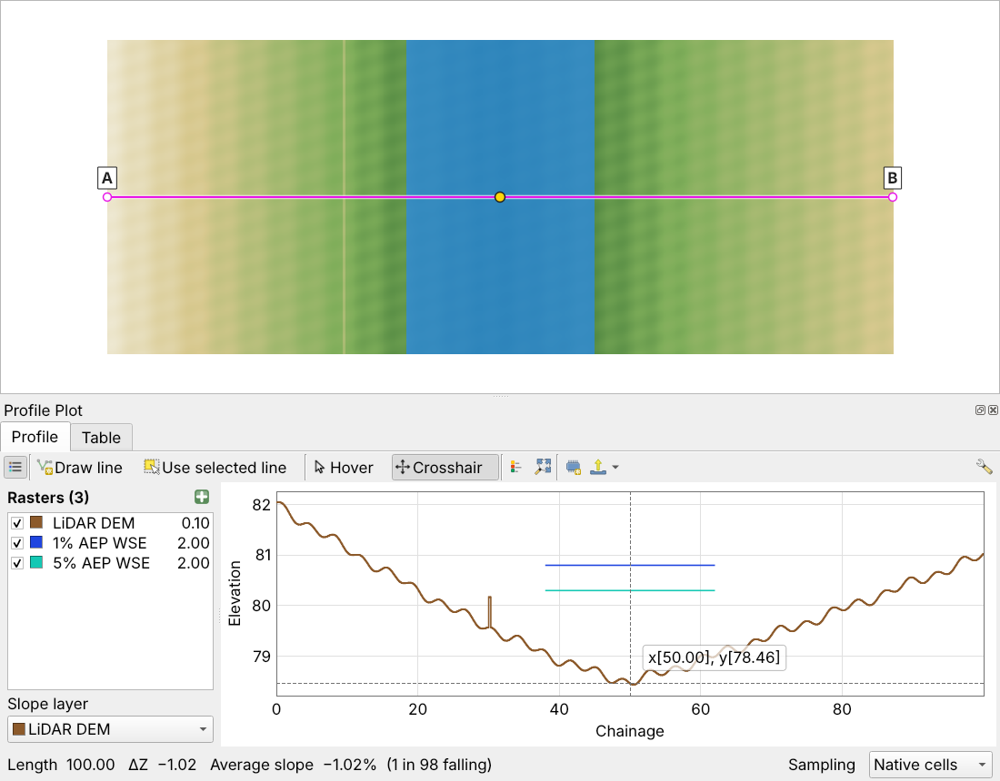
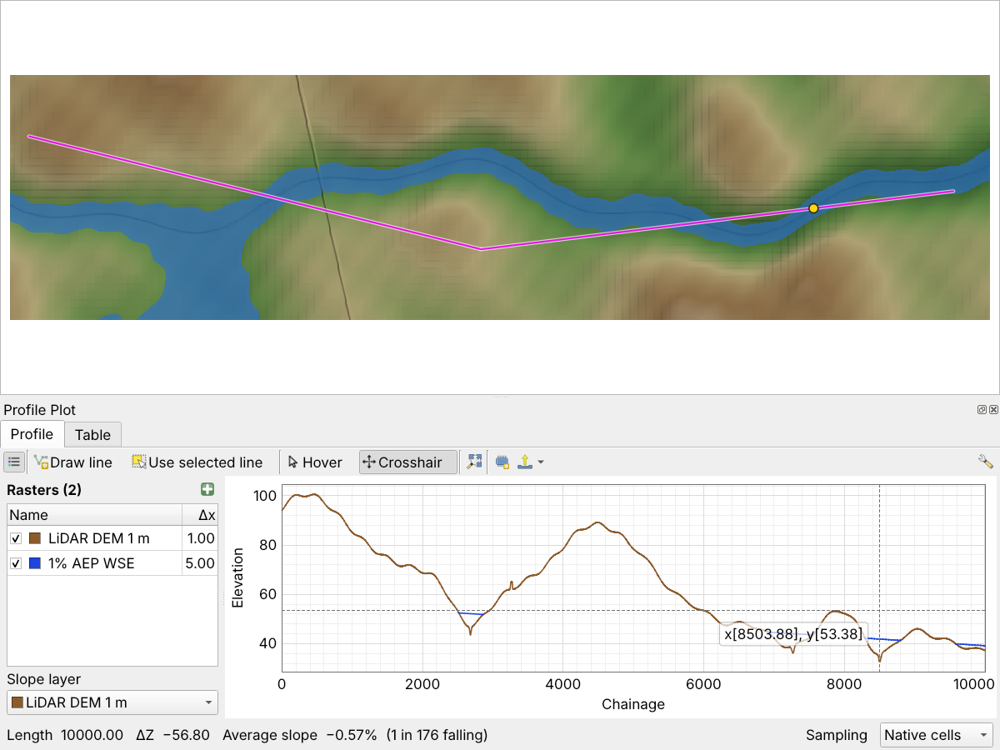
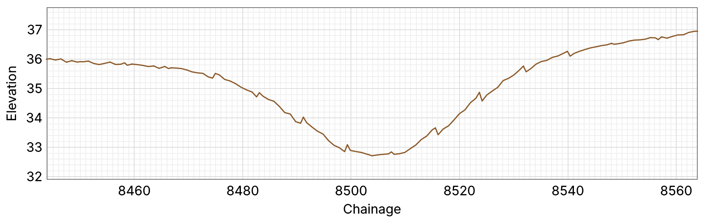
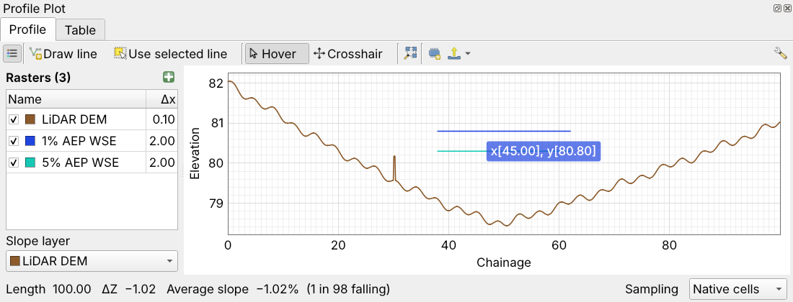
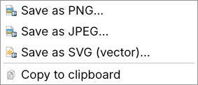
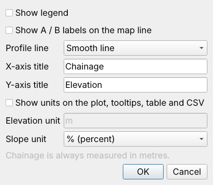

# Profile Plot

**Fast raster profiles for QGIS.** Press one shortcut, click a line on the map, and the
profile of every raster you picked appears straight away: LiDAR DEMs, flood water surfaces,
design surfaces and so on. It updates live while you draw, and the finished profile is at each
raster's native resolution.



**A 10 km profile across a 1 m LiDAR DEM with a flood surface.** In the build container the
plot appeared about 65 ms after the line was set and was complete, all 10,432 native cells,
in about 90 ms:



**Zoom in on the same profile: the line passes through every 1 m cell value:**



The profile is drawn as a smooth elevation line through the raster cell values. If you prefer
to see each cell as a flat step, choose *Profile line: Steps* in Settings.

---

## Contents

1. [Features](#features)
2. [Install](#install)
3. [Quick start](#quick-start)
4. [Assign your shortcut](#assign-your-shortcut)
5. [Drawing a line](#drawing-a-line)
6. [The dock, part by part](#the-dock-part-by-part)
7. [Reading the plot](#reading-the-plot)
8. [Sampling modes](#sampling-modes)
9. [Length, ΔZ and average slope](#length-δz-and-average-slope)
10. [Table and CSV export](#table-and-csv-export)
11. [Exporting the line and the plot](#exporting-the-line-and-the-plot)
12. [Settings](#settings)
13. [Rasters, CRSs and accuracy](#rasters-crss-and-accuracy)
14. [Speed](#speed)
15. [Troubleshooting](#troubleshooting)
16. [Development](#development)

---

## Features

* **One action, one shortcut.** The toolbar icon and the shortcut you assign open the dock and
  start drawing. If the dock is already open, they start a new line.
* **Live while drawing.** The plot follows the mouse, including the segment from the last vertex
  to the cursor.
* **Stays in draw mode.** After you finish a line, the next click starts a new profile.
* **Any number of rasters on one chainage.** DEMs and water surfaces in any CRS and at any
  resolution share one chainage axis.
* **Native-cell sampling.** Every cell the line crosses is kept, including a short diagonal clip
  through a narrow kerb or embankment. Optional 1 cm stations, with or without bilinear
  interpolation.
* **Hover and crosshair inspection.** Hover shows a vertical guide with every plot's value;
  crosshair shows the chainage and elevation at the cursor. A yellow dot marks the same station
  on the map.
* **Optional slope layer.** Live length, ΔZ and average slope, in % or m/m.
* **Exports.** A table tab with CSV export, the line as a temporary layer, and the plot as PNG,
  JPEG, SVG or clipboard.
* **No extra installs.** It uses only what ships with QGIS (Qt, numpy, GDAL) and works offline.

## Install

**Requirements:** QGIS 3.34 or newer, including QGIS 4 (Qt6).

The repository root *is* the plugin (`__init__.py`, `plugin.py`, `metadata.txt`, `icon.svg`,
`core/`, `ui/`, `icons/`), so any of these work:

| Method | Steps |
|---|---|
| Plugin ZIP (recommended) | `python3 scripts/package.py` writes `dist/profile_plot-1.0.zip` (top folder `profile_plot`, without tests and docs). In QGIS: *Plugins ▸ Manage and Install Plugins ▸ Install from ZIP*, choose it, then *Install Plugin*. |
| GitHub *Download ZIP* | *Code ▸ Download ZIP* on GitHub, then *Install from ZIP* as above. QGIS installs it as `profile-plot-main`. |
| Git clone | Clone into your plugins folder as `profile_plot`: `git clone https://github.com/irenejaya/profile-plot.git profile_plot`. Find the plugins folder with *Settings ▸ User Profiles ▸ Open Active Profile Folder*, then `python/plugins`. Enable **Profile Plot** in the Plugin Manager. |

Use one method only. Installing a second way adds a second copy (for example `profile_plot`
and `profile-plot-main`), so uninstall the first one before switching.

After installing, the **Profile Plot** icon appears on its own **Profile Plot** toolbar (show
or hide it under *View ▸ Toolbars*) and under *Raster ▸ Profile Plot*.

## Quick start

1. **Open:** click the Profile Plot icon on the Profile Plot toolbar. The dock opens at the
   bottom of the window.
2. **Add rasters:** select your raster(s) in the Layers panel and click the green **+**. They
   are added straight away, with no dialog. You can also drag layers into the dock from the
   Layers panel or the Browser. With no raster selected, **+** opens a list of the project's
   rasters plus *Browse files…*.
3. **Draw:** click the icon again (or press your shortcut, or click **Draw line**). Click
   points on the map, then right-click to finish.

The profile is ready as soon as you finish, usually within a fraction of a second. To check
another spot, just click on the map again.

**Closing the dock resets the tool:** the line, the plot, the table, the raster list and the
slope layer are cleared, so the next time you open it you start fresh. Your Settings are kept.

## Assign your shortcut

The toolbar icon and **Draw line** share one action, **Profile Plot**. It has **no default
key**, so it never clashes with your existing shortcuts.

1. Open *Settings ▸ Keyboard Shortcuts*.
2. Search for **Profile Plot**.
3. Click *Change*, press your keys (for example `Ctrl+Alt+L`), then *OK*. QGIS warns you if
   the keys are already in use.

What the shortcut does:

| Dock state | Shortcut / icon does |
|---|---|
| closed | opens the dock and starts drawing |
| open | starts a new line |
| open, no rasters yet | keeps the dock open and points you to **+** |

The assigned keys are shown in the icon's and the **Draw line** button's tooltips.

## Drawing a line

| Action | How |
|---|---|
| Add a vertex | left-click (snaps if snapping is on in your project) |
| Undo the last vertex | Backspace (or Delete) |
| Finish | right-click (or Enter) |
| Cancel the line in progress | Esc |
| Leave the tool | Esc with no line in progress, or pick another map tool |
| New profile after finishing | just click again: the tool stays active |
| Profile an existing line | select a line feature, then click **Use selected line** |

While you draw, the finished part of the line is solid magenta and the moving part is dashed.
By default only the line is drawn. To mark the start (**A**, chainage 0) and the end (**B**),
tick *Show A / B labels on the map line* in Settings. The line stays on the map until you start
a new line or close the dock.

## The dock, part by part



### Toolbar (left to right)

| Button | What it does |
|---|---|
| ☰ Rasters | Shows or hides the raster list (compact layout). |
| **Draw line** | Starts line capture. Same action as the plugin icon and your shortcut. |
| **Use selected line** | Profiles the selected line feature, using the active layer first. Curved lines are segmentised; for a multipart line the first part is used. |
| **Hover** / **Crosshair** | Inspection mode, see [Reading the plot](#reading-the-plot). Your choice is remembered. |
| Zoom full | Fits the whole profile. |
| Export line to temporary layer (scratch-layer icon) | Adds a temporary layer *Profile alignment* with the original vertices, direction and CRS. Enabled once a line is finished. |
| Export plot image ▾ | Click the icon to save a PNG. The arrow offers PNG, JPEG, SVG (vector) or *Copy to clipboard*. |
| Settings (gear) | Legend, units and slope unit, see [Settings](#settings). |

### Raster table

| Column | Meaning |
|---|---|
| **Name** (tick, colour, name) | Tick to show or hide the curve. Click the colour box to choose any colour with the QGIS colour picker. |
| **Δx** | Resolution (cell size) of the raster, in its CRS units. |

* **Add:** select raster(s) in the Layers panel and click **+**; they are added at once.
  With nothing selected, **+** opens a list of project rasters and *Browse files…*. You can
  also drag layers from the Layers panel or Browser.
* **Reorder:** drag rows. The table and CSV follow this order.
* **Row menu (right-click):** *Band* (for multi-band rasters), *Move up/down*,
  *Change colour…*, *Remove*.
* **Preset colours**, in the order you add rasters:

  | Raster | Colour |
  |---|---|
  | 1st (DEM) | brown |
  | 2nd–6th (water levels) | blue, cyan, violet, orange, green |
  | 7th onwards | red |

  You can change any of them.
* The list starts empty each time you open the dock (closing the dock clears it). The panel
  widens to fit long names.

### Slope layer

Below the raster table, choose which raster drives ΔZ and the average slope, or leave it as
**(none)**. When the raster list is hidden, the selector moves into the footer next to the
grade.

### Footer

`Length 100.00   ΔZ −1.45   Average slope −1.45% (1 in 69 falling)   …   Sampling [Native cells]`

ΔZ and the slope show only when a slope layer is selected and its curve is visible. See
[Length, ΔZ and average slope](#length-δz-and-average-slope).


## Reading the plot

| Mode | Tooltip | Shown |
|---|---|---|
| **Crosshair** | `x[50.00], y[78.50]` on translucent white: chainage and elevation at the cursor, also between curves | whenever the pointer is in the plot |
| **Hover** | A dashed vertical guide at the pointer. A box at the top lists the value of each plot at that chainage: a coloured dot and the value, highest first, no names. The chainage itself shows in a dark label on the X axis. | whenever the pointer is in the plot |

* **Map marker:** in both modes a yellow dot marks the same station on the map line, even on a
  line you are still drawing. It disappears when the pointer leaves the plot.
* **Legend** (off by default; turn on in Settings): a corner box listing each raster and its
  value at the pointer.
* **Line:** a smooth line through the raster cell values (default), or flat steps, one per cell
  (Settings ▸ Profile line). Zoomed out, the drawing is simplified to a few points per screen
  column. The kept points stay at their true chainage, so the line looks the same as at full
  resolution and narrow spikes are not lost. The tooltip and legend show the cell's own value,
  so they match the table and CSV.
* **Grid:** labelled lines, plus a light minor grid (every 1 m where it is legible, otherwise a
  regular subdivision).
* **Gaps:** NoData breaks a curve. Gaps stay visible at every zoom level.
* **Preview label:** *Preview from overview — refining…* appears while full-resolution values
  are still loading. See [Speed](#speed).

| Navigation | Effect |
|---|---|
| mouse wheel | zoom around the pointer |
| Ctrl + wheel | zoom chainage only |
| Shift + wheel | zoom elevation only |
| drag | pan |
| double-click, Home or Zoom full | fit the whole profile |
| right-click | *Zoom full* and the image export options |


## Sampling modes

Choose in the footer's **Sampling** box. Your choice is remembered.

| Mode | What you get | Use it for |
|---|---|---|
| **Native cells** (default) | Every cell the line crosses over a positive distance, with its entry and exit chainage. Corner-only touches are ignored. Drawn as a smooth line through the cell values, or as steps (Settings). | Checking the DEM as it really is, without interpolation. |
| **1 cm stations** | A value every 0.01 m (0.00, 0.01, 0.02, …) plus the end station, taken from the cell under each station. A 100 m line gives 10,001 stations. | Fixed-interval output for other software. |
| **1 cm bilinear** | The same stations, bilinearly interpolated between cell centres. Labelled *(bilinear)* and drawn dashed. | Smooth surfaces; interpolated values are always labelled. |

Cell edges are half-open: a point exactly on an edge belongs to the cell on its right or
below.

## Length, ΔZ and average slope

* **Length:** horizontal chainage length, measured along every bend of the line.
* **ΔZ:** the elevation difference along the line on the slope layer, end value − start value
  (B − A). `ΔZ −1.02` means B is 1.02 m lower than A.
* **Average slope:** signed net grade, (end − start) ÷ length, over the whole line, in % or m/m
  (see Settings).

| Example | Result |
|---|---|
| 82.00 → 80.55 over 100 m | `−1.45% (1 in 69 falling)` or `−0.0145 m/m` |
| same line drawn the other way | `1.45% (1 in 69 rising)` |
| flat | `0.00%` |
| an end outside the raster, or on NoData | *unavailable* |
| valid ends, NoData in between | value plus *endpoint grade across gap, coverage 87%* |
| values still loading | value plus *(preview)*. A preview grade is never shown as final. |

## Table and CSV export


The **Table** tab has one column per visible raster, in table order.

| Sampling | Rows |
|---|---|
| Native cells | **From / To** chainage intervals. A new row starts whenever any raster crosses a cell boundary. |
| 1 cm modes | one **Chainage** row per station |

* **Export CSV** writes every row once all values are final. Gaps are written as `NoData`.
* Values keep the precision of the source raster.
* When units are on, headings carry them, for example `From (m)` and `LiDAR DEM (m AHD)`.

## Exporting the line and the plot

| Export | Result |
|---|---|
| Export line to temporary layer | Memory layer *Profile alignment*: original vertices, direction and CRS, plus `length_m` and `vertices` fields. |
| Save as PNG / JPEG | The plot at 2× screen resolution, without the pointer overlay. |
| Save as SVG | Vector image for reports; editable in Inkscape or Illustrator. |
| Copy to clipboard | Paste straight into email, Word or PowerPoint. |

Images match what you see, including the legend if it's on.



## Settings



| Setting | Default | Effect |
|---|---|---|
| Show legend | off | Corner box with each raster and its value at the pointer. |
| Show A / B labels on the map line | off | Marks the start (A) and end (B) of the line on the map. Off: only the line. |
| Profile line | Smooth line | *Smooth line* through the cell values, or *Steps (native cells)*. |
| X-axis title | Chainage | Title under the plot. Leave it empty to return to the default. |
| Y-axis title | Elevation | Title beside the plot. Leave it empty to return to the default. |
| Show units | off | Adds `m` to the X axis and your elevation unit to the Y axis, plus units in the tooltips, footer, table and CSV headings. |
| Elevation unit | `m` | Label used when units are shown, e.g. `m AHD`, `ft`. |
| Slope unit | % | Average slope in % or m/m. |

Settings, the inspection mode and the sampling mode are remembered between sessions. The
raster list, the line and the plot are not: closing the dock clears them.

## Rasters, CRSs and accuracy

* **Supported data:** any raster QGIS can open. Files GDAL reads directly are fastest: GeoTIFF
  and COG, VRT, ESRI ASCII, `.flt`, ECW, NetCDF and so on, on local disks or network drives.
  Other sources (WCS, databases) are read through QGIS.
* **Chainage CRS:** distances are measured in a local projected CRS in metres:
  * your map CRS when it's projected in metres (e.g. MGA / UTM);
  * otherwise (geographic or Web Mercator) a transverse Mercator centred on the line.
* **Mixed CRSs:** each raster is sampled in its own CRS. The line is densified wherever the
  transformation bends it (within 0.05 pixel), and cell crossings are mapped back to the common
  chainage.
* **Grids:** rotated and rectangular pixels are handled through the full geotransform.
* **Values honoured:** band scale and offset, masks, source NoData, and QGIS's
  *use source NoData* / *additional NoData* settings for each layer.
* **File changes:** if a raster file is rewritten (e.g. you re-run a flood model), the next line
  picks up the new values.

## Speed

How Profile Plot keeps the plot instant:

* **Reads only what's needed.** Only the raster tiles the line touches are read, aligned to the
  file's internal blocks, and decoded tiles are cached (384 MB cap). Worker threads do the
  reading; interactive work goes first, and long lines are split so all cores help.
* **Samples incrementally.** Finished segments are cached, and only the moving segment is
  resampled.
  * Very long moving segments show a labelled preview (from overviews, or sparse samples) and
    refine to full resolution when the mouse rests.
  * After a click, the preview stays on screen until full resolution arrives, so the plot never
    flashes empty.
* **Never shows stale data.** A late result from an older line is never displayed.
* **Repaints cheaply.** Axes and curves are cached as an image, so moving the pointer only
  repaints the tooltip, crosshair and readout. Zoomed out, each screen column keeps the first,
  min, max and last values of each continuous run, so spikes survive.

**Benchmark** (`scripts/benchmark.py`): two 1 km × 10 m rasters at 1 cm, i.e. 100,000 ×
1,024 px, tiled and compressed. Measured in the build container (4-core Xeon 2.1 GHz, QGIS
3.34, headless), not a desktop, so your numbers will differ:

| Measure (target) | p50 | p95 |
|---|---|---|
| Pointer → station guide (≤ 16 ms) | 0.8 ms | 1.2 ms |
| Map edit → first preview, tail up to 1 km (≤ 100 ms) | 37 ms | 51 ms |
| 1 km, two 1 cm grids → final values, warm (≤ 1 s) | 208 ms | 269 ms |
| 1 km, two 1 cm grids → final values, cold cache | 582 ms | 715 ms |

The 10 km mock-up above (1 m DEM plus a 5 m flood surface) took about 65 ms to the first plot
and 90 ms to all native values.

## Troubleshooting

| You see | Why / what to do |
|---|---|
| What is ΔZ in the footer? | End minus start elevation of the slope layer (B − A). Shown only when a slope layer is selected. |
| How do I see which end is chainage 0? | Tick *Show A / B labels on the map line* in Settings: A is the start (chainage 0), B the end. |
| *Average slope unavailable* | An end of the line is outside the slope raster or on NoData. Move the ends onto data. |
| *endpoint grade across gap, coverage …* | The ends are valid but the line crosses NoData. The grade uses the two ends. |
| *Preview from overview — refining…* | Full-resolution values are still loading (large rasters, network drives). It disappears when done; Export CSV waits for it. |
| No ΔZ or slope in the footer | No slope layer is selected, or its curve is hidden. |
| The icon only opens the dock | No rasters are added yet. Click **+** first. |
| *Cannot read this raster* | The source isn't readable. Check the file path or connection in the layer's properties. |
| Shortcut does nothing | Assign it first (see [Assign your shortcut](#assign-your-shortcut)), or check for a clash in *Keyboard Shortcuts*. |
| `Couldn't load plugin 'profile-plot/profile_plot'` / `No module named 'profile-plot/profile_plot'` | An older copy of this repository, from when the plugin sat in a subfolder, was installed. Close QGIS and delete the folder `profile-plot` from `…\QGIS3\profiles\default\python\plugins`. Then install again using one of the methods in [Install](#install). |
| Plugin Manager says the version is older | You installed a test build with a higher number. Uninstall Profile Plot, then install the ZIP. Your settings are kept. |

## Development

```bash
# unit tests (tests/) + headless QGIS tests (tests/qgis/, needs the QGIS Python bindings)
QT_QPA_PLATFORM=offscreen python3 -m pytest tests

# speed benchmark (writes ~1 GB of 1 cm test rasters to OUT_DIR)
QT_QPA_PLATFORM=offscreen python3 scripts/benchmark.py /tmp/pp-bench

# screenshots for this README
QT_QPA_PLATFORM=offscreen python3 scripts/screenshot.py /tmp/pp-shots
QT_QPA_PLATFORM=offscreen python3 scripts/mockup_10km.py /tmp/pp-10km

# installable ZIP in dist/
python3 scripts/package.py
```

### Project layout

The layout follows the usual QGIS plugin repository shape: the root is the plugin package.

| Path | Role |
|---|---|
| `__init__.py` | QGIS entry point (`classFactory`) |
| `plugin.py` | The shared action, the Profile Plot toolbar and the Raster menu entry |
| `metadata.txt`, `icon.svg` | Plugin metadata and icon |
| `core/sampling.py` | Pure-numpy kernels: grid traversal, stations, bilinear, grade |
| `core/readers.py` | GDAL / QGIS tile reading, tile cache, dataset pool |
| `core/engine.py` | Worker threads with priorities and cancellation |
| `core/session.py` | Rasters, the line, background jobs, profile assembly, reset |
| `core/assembly.py` | Joins pieces into profiles; grade; table rows |
| `core/geometry.py` | CRS choice, chainage, densified pixel-space pieces |
| `core/export.py` | Temporary layer export and the CSV writer |
| `core/settings.py` | Stored preferences |
| `core/compat.py` | Small helpers so one code base runs on Qt5 and Qt6 |
| `ui/dock.py` | The dock: toolbar, raster panel, plot, footer, table tab |
| `ui/plot_widget.py` | QPainter chart: cache, simplification, hover / crosshair, export |
| `ui/map_tool.py` | Line capture tool and the map overlay (line, A/B, marker) |
| `ui/raster_list.py` | Raster table, colour boxes, slope selector, Add raster dialog |
| `ui/table_view.py` | Table tab |
| `ui/settings_dialog.py` | The settings dialog |
| `ui/icons.py`, `icons/` | Icons (QGIS theme icons where available) |
| `scripts/` | `package.py` (plugin ZIP), `benchmark.py`, `screenshot.py`, `mockup_10km.py` |
| `tests/` | Unit tests; `tests/qgis/` holds the headless QGIS tests and their harness |
| `docs/images/` | Screenshots used in this README |

### What the tests cover

* Native-cell traversal against hand-built grids: a diagonal crest, the grid edge, a rotated
  grid, a NoData hole, offset water-surface cells, and a raster in another CRS.
* The −1.45 % grade example, including its sign flip.
* Agreement between the inspection readout and the CSV.
* Rapid redraws never restoring an older line.
* The shortcut tooltips.
* Exported vertices, direction and CRS.
* Settings, colours, tooltips, image export and the map marker, driven by real mouse events.
* The plugin ZIP layout, the own toolbar, and the reset when the dock is closed.

## License

GPL-3.0, see [LICENSE](LICENSE).
